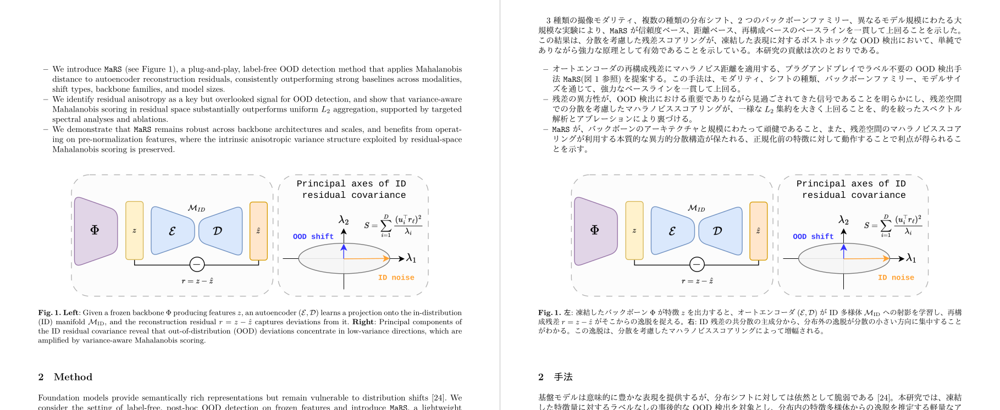
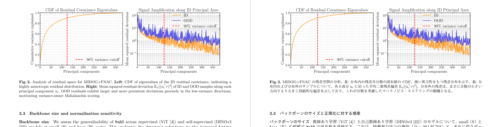

# JPaper

> English summary: JPaper translates academic papers into Japanese. It takes the LaTeX source of a paper (an arXiv ID, a .tex file, a zip or tar.gz archive, or a directory) and produces a typeset Japanese PDF and a landscape side-by-side PDF (original on the left, Japanese on the right), along with a per-paper glossary. Translation and quality review are done by an LLM (Claude Code CLI, Codex CLI, Ollama or OpenRouter), while the control flow, retry limits and formal checks are plain TypeScript. Japanese is the only target language, and the rest of this README and the documentation are written in Japanese. Requirements: Node.js 22.5+, pnpm 10+, LaTeX (LuaLaTeX and latexmk) and one of the LLM providers above. Licensed under the MIT License.

学術論文の**和訳に最適化した決定的専門エージェント**。agent-native な設計の原則（**配線はコード、内容の判断は LLM**）に従い、配線は YAML ではなく素の TypeScript のワークフローとして書く。Flue の Agent と Workflow の分け方を参考に、薄い自作のランタイムで実装している。

採用したアーキテクチャの方針は [`docs/adr/`](./docs/adr/) を参照。

## 何をするか

- **入力**: 学術論文の LaTeX ソース（arXiv、zip・tar.gz）を最優先で扱う。ソースが無く PDF しか無い論文・書籍（テキスト層のあるもの）は、本文の語句をテキスト層から取り、数式と構造を LLM にページ画像から起こさせて訳す（claude・codex だけ。[PDF 入力 ADR](./docs/adr/20261015-pdf-input-text-layer-as-source-llm-rebuilds-math.md)）。見た目は原本を再現しない。図はキャプションの上の空白を原本から画像として切り出して貼る（キャプションの無い図は「原本の何ページ目を参照」の目印のまま）。
- **出力**: 日本語 PDF（LuaLaTeX で組版）と、横長（A4 縦 2 枚分）で左に原文、右に和訳を並べた対訳 PDF。
  - ファイル名は `<ID>_<短い英語名>-ja.pdf`・`<ID>_<短い英語名>-bilingual.pdf` で、出力先の直下に置く（例 `2507.17845_pathorob-ja.pdf`）。短い英語名はタイトルを訳すときに LLM が決め、決まらなければ `2507.17845-ja.pdf` になる（[成果物 PDF の名前 ADR](./docs/adr/20261007-name-deliverable-pdfs-by-id-and-slug.md)）。
  - 対訳 PDF は `--no-bilingual` を付けると作らない。対訳の組版だけが失敗しても run は成功し、`RunSummary.bilingual` とエラー出力に理由が出る（[対訳 PDF ADR](./docs/adr/20261006-bilingual-side-by-side-pdf.md)）。
  - あわせて、論文ごとの用語集（`glossary.md`）と実行の記録を残す。
- **品質**: 訳す役（`translator`）と品質を判定する役（`evaluator`）を分けている。検査は、節ごとの軽い形式検査と evaluator、組み上げた後の全文の組版ゲートの 2 層からなる。合格したらループを抜け、上限（`MAX_REVISIONS`）を超えたら明示的に失敗する（[品質ゲート ADR](./docs/adr/20260708-quality-gate-machine-vs-llm-and-explicit-failure.md) / [2 層化 ADR](./docs/adr/20260709-quality-gate-two-layer-and-build-error-triage.md)）。

## 見本

対訳 PDF の一部（左が原文、右が和訳）。図・数式・相互参照は原文のまま持ち越し、本文とキャプションを訳す。





原文: Francesco Di Salvo, Sebastian Doerrich, Christian Ledig「MaRS: Robust Out-of-Distribution Detection via Mahalanobis Residual Scoring」（[arXiv:2606.22649](https://arxiv.org/abs/2606.22649)、[CC BY 4.0](https://creativecommons.org/licenses/by/4.0/)）。JPaper で和訳した対訳 PDF の 2 ページから一部を切り出した（画像も CC BY 4.0。作り方は [`docs/images/readme/make_samples.py`](./docs/images/readme/make_samples.py)）。

## アーキテクチャ

agent-native の考え方と Flue の設計に沿って、次のように分けている。

- Agent（誰が）: `translator`・`evaluator`・`glossary-builder` など。`src/agents/<id>.ts` に定義する。薄い自作のランタイムは `src/runtime/` にある。
- Tool（何ができるか）: エージェントが使う TS の関数。実装は `src/tools/`。
- Skill（何を知っているか）: 用語やスタイルの規約などの知識。必要になった分だけ段階的に読み込む（`.agents/skills/`）。
- Workflow（配線）: `src/workflows/*.ts` の素の TS の関数で、複数のエージェントをつなぐ（`Promise.all` / `for` / `if`）。順序・並列・上限は TS が固定し、品質の判定は LLM が行う。
- 知識の正本: 用語集・スタイルガイドなどは `input/` に置き、commit する。
- ファイルの配置: 全体の状態は `~/.jpaper/` に置く（論文をまたいで共有する `glossary.db` と設定）。論文ごとの成果物と実行の記録は、隠しフォルダではない `./article/<paper>-ja/` に置く（`source/`・`figures/`・`glossary.md`・`translation/`・`<ID>_<短い英語名>-ja.pdf`・`<ID>_<短い英語名>-bilingual.pdf`・`.run/`）。`--out` で変えられる（[UI/配置 ADR](./docs/adr/20260709-user-interface-file-layout-and-cli.md)）。

決定性の方針として、ループの上限・並列・分岐は素の TS（`for` / `Promise.all` / `if`）で書き、契約の検査は zod で行う。品質の判定・行き詰まりの判断・介入は LLM に任せる。ランタイムは Flue の Agent/Workflow の設計を借りた薄い自作のもので、将来 durable な実行・観測・複数環境へのデプロイが必要になれば Flue へ移れるよう、形を寄せている。詳細は [ADR](./docs/adr/20260708-adopt-deterministic-agent-architecture.md) を参照。

## セットアップ

### 前提ツール

- Node.js（22.5 以上）と pnpm（10 以上。`brew install pnpm` か `corepack enable`）: 本体の実行とテスト
- LaTeX（`latexmk`・LuaLaTeX）: 組版
- poppler（`pdfinfo`・`pdftotext`・`pdftocairo`。`brew install poppler`）: PDF を入力にするときだけ
- `gh`（GitHub CLI）: issue / PR の確認と初期設定
- Python 3（`python3`）: hook の設定と一部の self-test
- Ruby（`ruby`）: skill の frontmatter の検査
- lefthook（commit-msg / pre-push のローカル hook）

```sh
pnpm install
pnpm setup         # PATH を通す設定をシェルの設定ファイル（~/.zshrc など）に書き足す（初回だけ）
source ~/.zshrc    # pnpm setup が書き足した設定を読み込む（zsh なら新しいターミナルを開いてもよい）
pnpm link --global # jpaper コマンドをどこからでも使えるようにする（初回だけ）
lefthook install   # commit-msg / pre-push フック（未導入なら brew install lefthook）
```

`pnpm setup` の後に同じターミナルで設定を読み直さないと、`pnpm link --global` は `ERR_PNPM_NO_GLOBAL_BIN_DIR` で失敗する。zsh 以外のシェルを使っている場合や `ZDOTDIR` を設定している場合は、`source ~/.zshrc` の代わりに、`pnpm setup` が最後に表示する `source …` の行を実行する。

`jpaper` コマンドは repo のソース（`src/cli.ts`）を tsx で直接動かすので、build は要らず、`git pull` するとそのまま新しい版で動く（`bin/jpaper.mjs`）。link した `jpaper` は、repo でその時 checkout している branch のコードを動かす。`pnpm link --global` を使わない場合は、repo の中で `pnpm dev` を `jpaper` の代わりに使える（ただし作業ディレクトリが repo 直下になるので、読む `.env` と、相対パスの `<input>`・`--out` の基準が repo 直下になる）。

OpenRouter の API キーなどは、`.env.example` を `.env` に写して書ける。CLI は作業ディレクトリの `.env` を、Web は repo 直下の `.env` を読み、シェルの環境変数のほうが優先される（詳細は [契約付録 §8](./docs/design/contract-appendix.md)）。

## 使い方

```sh
jpaper <arXiv ID|ファイル|ディレクトリ> --provider {ollama|claude|codex|openrouter} [--out DIR] [--no-bilingual] [--no-verify-terms]
jpaper paper.pdf --provider claude [--pages 1-72] [--yes]
```

PDF は、ページごとに画像とテキスト層を LLM に渡して LaTeX に起こしてから訳す。テキスト層と照らして語の欠けがあれば読み直させ、それでも駄目なページは原本の画像を貼って未訳にする（`RunSummary.pdf.fallbackPages`）。読むページが 100 を超えると、端末では読み取りの目安を出して確認し、端末でなければ `--yes` か `--pages` が要る。テキスト層の無いスキャンした PDF は扱わない（[契約付録 §8「PDF 入力」](./docs/design/contract-appendix.md)）。

LLM に渡したくない語（自分の名前など）は、1 行 1 語のファイルに書いて `--redact-file names.txt` で渡す。語は取り込みの段で `***` に置き換わり、翻訳・評価・用語集作り・用語の Web 検索のどの LLM 呼び出しにも渡らず、和訳 PDF・対訳 PDF・用語集にも残らない。PDF の入力では、ページ画像のその語の位置を白く塗ってから渡す。図の中の画像の文字のように、テキスト層に無い文字は消せない（[伏せ字 ADR](./docs/adr/20261015-redact-terms-at-ingest-never-send-to-llm.md)）。

和訳 PDF（例 `article/2507.17845-ja/2507.17845_pathorob-ja.pdf`）と対訳 PDF（例 `article/2507.17845-ja/2507.17845_pathorob-bilingual.pdf`）のパスを標準出力に出し、`RunSummary` を JSON で出す。

claude・codex では、翻訳の前に用語集の訳を CLI の Web 検索で既存の日本語の用例と照らし、出典の取れた表記に差し替える。用例を確かめられない語は「未確認」の訳注になる。`--no-verify-terms` で止められる（[用語の検証 ADR](./docs/adr/20261013-verify-unconfirmed-terms-with-cli-web-search.md)）。オプションの一覧は `jpaper --help` で表示できる。オプションの正本は [契約付録 §5](./docs/design/contract-appendix.md)。

### LLM プロバイダ

LLM プロバイダは `LlmClient` の境界で差し替えられる。ローカルの Ollama、公式 CLI を子プロセスで動かすクラウド（`claude -p` / `codex exec`）、OpenRouter（OpenAI 互換 API）の 4 つの実装があり、`--provider {ollama|claude|codex|openrouter}` は**必須（既定なし）**。claude と codex では `--model` / `--effort` を CLI に渡し、指定しなければ最新の中位モデル（claude は Sonnet、codex は Sol）と effort medium を使う。LLM クライアントは薄い自作のランタイムの中に閉じ込める（[プロバイダ ADR](./docs/adr/20260709-llm-provider-abstraction-local-ollama-and-cloud-cli.md)）。

### Web アプリ（検索・翻訳・用語集）

```sh
pnpm dev:web
```

ブラウザで `http://127.0.0.1:5173` を開くと、`article/` の論文と用語集、全体の用語 DB を見られる。用語の行から訳語を直すと、訳文での出現箇所を原文の対応箇所と合わせて確かめてから置換し、和訳 PDF と対訳 PDF を組み直す。置換にも組み直しにも LLM は使わず、直前の 1 回は元に戻せる。データの場所は CLI と同じ既定（CWD の `article/` と `~/.jpaper/glossary.db`）で、`JPAPER_ARTICLE_DIR`・`JPAPER_GLOSSARY_DB` で変えられる。`127.0.0.1` だけで待ち受け、認証は持たない。仕様の正本は [契約付録 §9](./docs/design/contract-appendix.md)。

画面は次の 3 つ。

- 探す: 手元の論文と arXiv の論文を 1 つの検索欄で探す。未訳の論文は「翻訳する」から翻訳の画面へ送れる（arXiv ID を直接入れてもよい）。
- 翻訳: provider・model・effort を毎回指定して、ジョブをキューに加える。段階・節 n/m・費用・経過時間・ログの末尾を見ながら、待機中・実行中のジョブを取り消せる。翻訳は CLI を子プロセスで動かすので、訳し終えた論文はそのまま一覧と用語集の編集の対象になる。arXiv ID の代わりに PDF（100MiB まで）を送って訳すこともでき（claude・GPT だけ）、送った PDF は `~/.jpaper/web-uploads/` と論文の出力先の `source/` に残る。読むページが 100 を超えるときは、始める前にページ数と読み取りの目安を出して確かめ、範囲を絞れる。
- 設定: フォームの初期値と、同時に走らせる本数（既定は 1 本ずつ、4 本まで）を決め、`~/.jpaper/web-settings.json`（`JPAPER_HOME`）に保存する。初期値を指定しなければ、claude は最新の Sonnet、GPT は最新の Sol を effort medium で使う。

ジョブは API のメモリにだけ持つので、API を止めると実行中の翻訳も止まる（同じ ID で始め直せば checkpoint から再開する）。翻訳が使う全体の用語 DB は CLI と同じ `JPAPER_HOME/glossary.db` で、`JPAPER_GLOSSARY_DB` は翻訳には効かない。

## コマンド

| コマンド | 用途 |
|---|---|
| `jpaper` | jpaper CLI（`bin/jpaper.mjs` が `src/cli.ts` を tsx で実行。`pnpm link --global` の後） |
| `pnpm dev` | jpaper CLI（`src/cli.ts`）を tsx で実行（repo の中で） |
| `pnpm dev:web` | Web アプリ（検索・翻訳・用語集の API と画面）を立ち上げる |
| `pnpm build` | `tsc` で `dist/` へビルドし、Web アプリの画面を `apps/web/dist/` へビルド |
| `pnpm typecheck` | 型チェックのみ（emit しない。Web アプリも含む） |
| `pnpm test` | vitest で単体テスト（決定的な検査で、LLM を含めない） |
| `bash tests/run-tests.sh` | 規約検査スクリプトの self-test（`scripts/` を変更したら実行） |
| `scripts/new-branch.sh <type> <issue番号> <slug>` | 規約を検証しながら topic branch を作成 |
| `scripts/check-pr.sh [<PR番号>]` | PR のタイトル・body・issue との連結をローカルで検査（PR の作成・編集後） |

## 開発ルール

運用ガイドは [`AGENTS.md`](./AGENTS.md)（`CLAUDE.md` は symlink）。issue 駆動・PR 必須・日本語 Conventional Commits・ADR による決定の記録を、最初から lefthook とローカルの検査で機械的に強制している。

検証はローカル script が正本（`bash tests/run-tests.sh` と `scripts/check-pr.sh`）。GitHub Actions（`.github/workflows/` の node-checks・pr-checks・self-test）は、同じ検査を Linux（self-test は macOS でも）でもう一度走らせる（[ADR](./docs/adr/20261014-enable-github-actions-on-public-repo.md)）。

Claude Code 用の権限の既定と hook は `.claude/settings.json` にある。read-only コマンドの allowlist、secret ファイルの Read の拒否、`scripts/hooks/` の Bash ガード、scripts を編集した後の自動 self-test、未コミットの差分に対する Stop 時の警告を設定している。

## ライセンス

[MIT License](./LICENSE)。ただし `docs/images/readme/` の見本の画像は、原文の論文と同じ [CC BY 4.0](https://creativecommons.org/licenses/by/4.0/)（出典は「見本」の節）。
